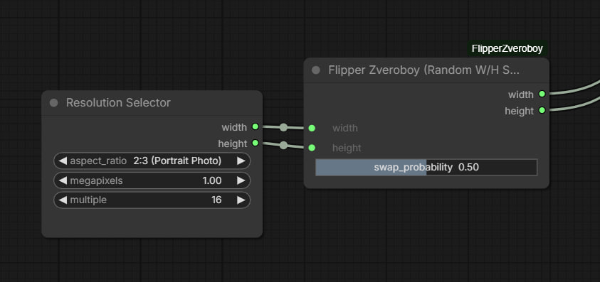

# ComfyUI-FlipperZveroboy

Кастомная нода для ComfyUI, которая случайно меняет местами значения `width` и `height`.

## Что делает нода

Нода принимает два целых числа:

- `width`
- `height`

При каждом запуске графа с заданной вероятностью значения могут быть поменяны местами.

По умолчанию вероятность равна `0.5`, то есть шанс 50/50.

Например:

- вход: `width = 768`, `height = 1024`
- вариант 1: выход останется `768 x 1024`
- вариант 2: выход станет `1024 x 768`

Таким образом, вертикальное разрешение с шансом 50% может стать горизонтальным.

## Параметры

| Параметр | Тип | Описание |
|---|---|---|
| `width` | INT | Входная ширина |
| `height` | INT | Входная высота |
| `swap_probability` | FLOAT | Вероятность обмена местами, от 0.0 до 1.0 |

При `swap_probability = 0.5` шанс обмена равен 50%.

## Установка

Установите репозиторий в папку `custom_nodes` вашего ComfyUI:

    cd ComfyUI/custom_nodes
    git clone https://github.com/ВАШ_ЛОГИН/ComfyUI-FlipperZveroboy.git

Или просто скопируйте папку проекта в:

    ComfyUI/custom_nodes/ComfyUI-FlipperZveroboy

После этого перезапустите ComfyUI.

## Использование

Добавьте ноду через поиск:

    Flipper Zveroboy

Или найдите её в категории:

    Zveroboy/Utils

Выходы ноды `width` и `height` можно подключить, например, к:

- `Empty Latent Image`
- `Empty Image`
- любой другой ноде, которая принимает размеры изображения

## Почему добавлен `IS_CHANGED`

ComfyUI кэширует результаты нод, если входные данные не изменились.

Чтобы случайная перестановка `width` и `height` происходила при каждом запуске, в ноде реализован метод `IS_CHANGED`, который принудительно инвалидирует кэш ноды.
